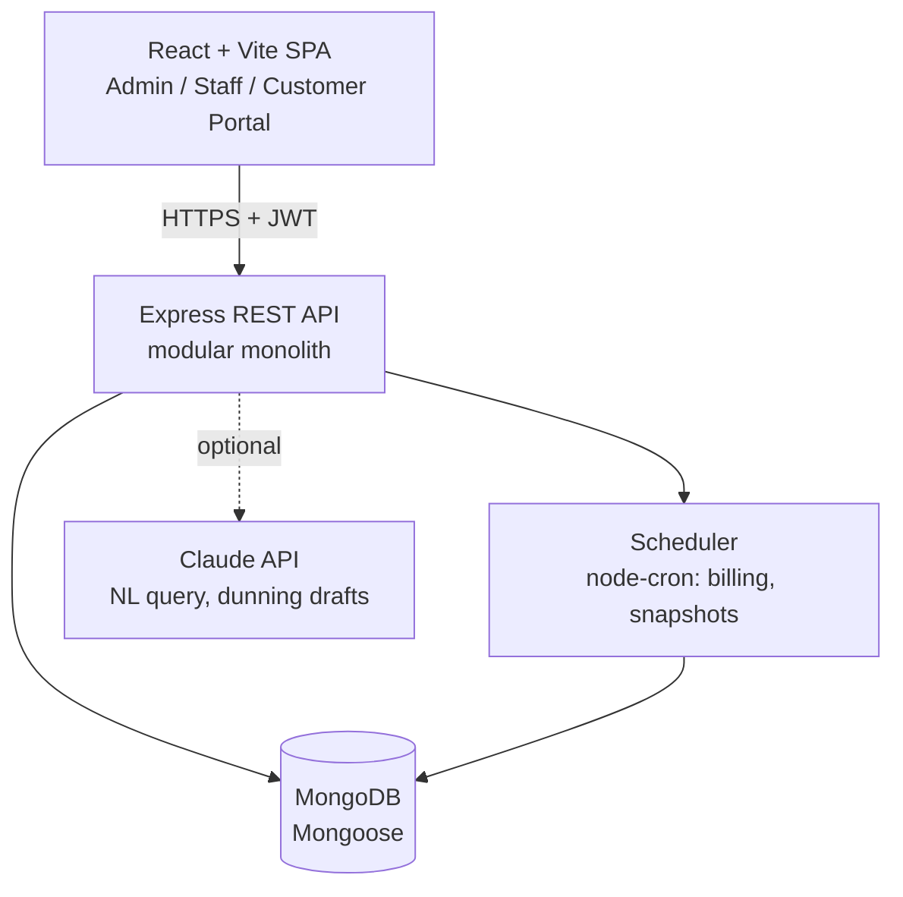

# NexSub Subscription Management System

> One platform to run plans, subscriptions and recurring billing: from catalog setup to invoices, payments and revenue reporting.


**Live demo:** `<your-deployed-url>` &nbsp;|&nbsp; **Demo video:** `<link>` &nbsp;|&nbsp; **Slides:** `<link>`

---

## The Problem

Brightloop Software sells everything on subscription, but runs it on spreadsheets: renewals get missed, invoices are typed by hand, payments are matched against bank statements, and nobody can say what the recurring revenue is.

## The Solution

A unified billing backbone covering the full subscription lifecycle:

```
Catalog -> Quotation -> Subscription -> Auto-Invoice -> Payment -> Revenue Reporting
```

One pricing engine powers quotes, invoices and dashboards, so the numbers never disagree.

## Key Features

**Core**
- Role-based access: **Admin**, **Staff**, **Customer** (own data only)
- Secure auth with password rules, unique emails and email-based password reset
- Products with variants (e.g. Brand = Odoo adds 560), plans (daily/weekly/monthly/yearly) with per-plan close, pause and renew rules
- Quotation templates with validity period
- Subscription lifecycle: `Draft -> Quotation -> Confirmed -> Active -> Closed`
- Automated invoice generation with taxes and discounts applied by rule
- Invoice lifecycle: `Draft -> Confirmed -> Paid` (confirm, cancel, send, print PDF)
- Discount rules (fixed or percent, min purchase or quantity, date window, usage limit)
- Payment recording (method, amount, date, note) with outstanding and overdue tracking
- Finance dashboard: active subscriptions, revenue, outstanding, overdue, with filters

**Differentiators**
- **Idempotent billing:** a unique compound index on `(subscription, periodStart)` guarantees nothing is billed twice; catch-up logic guarantees nothing is skipped
- **Billing Run console** with dry-run preview and per-subscription result log
- **Demo Clock** to simulate a whole billing month in minutes
- **Margin guard** warns when a discount drops below the cost-based floor
- **Price explainer** shows how every invoice line was calculated
- **Optional AI (Claude API):** natural-language report queries and dunning email drafts, behind a feature flag; billing works with AI off

## Architecture



**Billing run flow**

```
Cron job or "Run now"
  -> atomically claim ACTIVE subscriptions with nextBillingDate <= run date
     (findOneAndUpdate sets a short lock lease, so parallel runs never grab the same one)
  -> per subscription, in one Mongo transaction:
       price -> discount -> tax (pricing engine)
       insert invoice (unique on subscription + periodStart)
       increment discount usage (guarded: usedCount < usageLimit)
       advance nextBillingDate (loop until caught up)
       auto-close if expired and plan allows
  -> log result: CREATED | SKIPPED_DUPLICATE | FAILED(reason)
```

## Tech Stack

| Technology | Use |
|---|---|
| React.js + Vite | Frontend |
| Node.js | Backend runtime |
| Express.js | REST API |
| MongoDB + Mongoose | Database |
| JWT | Authentication |
| bcrypt | Password hashing |
| Tailwind CSS | UI styling |
| Recharts | Dashboard charts |

Small supporting libraries: `zod` (validation), `node-cron` (scheduler), `nodemailer` (reset links and invoice emails), `pdfkit` (invoice PDFs), `helmet`, `cors`, `express-rate-limit`, `@anthropic-ai/sdk` (optional AI).

## Project Structure

```
.
├── client/                     # React + Vite
│   └── src/
│       ├── pages/              # admin/, staff/, portal/, auth/
│       ├── components/         # tables, status chips, charts (Recharts)
│       ├── hooks/ api/ routes/ # data fetching, axios client, role-guarded routes
│       └── main.jsx
├── server/
│   └── src/
│       ├── modules/            # auth, users, catalog, rules, quotations, subscriptions,
│       │                       # pricing, billing, invoices, payments, reports, ai
│       ├── models/             # Mongoose schemas
│       ├── middleware/         # auth, rbac, validate, error handler
│       ├── jobs/               # billing scheduler, daily metrics snapshot
│       ├── seed/               # demo data generator
│       └── app.js
├── docker-compose.yml          # MongoDB (replica set), server, client
├── .env.example
└── README.md
```

## Getting Started

### Prerequisites

- Node.js 20+
- MongoDB 7+ running as a **replica set** (needed for transactions). MongoDB Atlas free tier works out of the box; the included `docker-compose.yml` starts a single-node replica set locally.

### Quick start

```bash
# 1. Clone
git clone https://github.com/<your-username>/<your-repo>.git
cd <your-repo>

# 2. Configure environment
cp .env.example server/.env
cp client/.env.example client/.env

# 3. Start MongoDB (skip if using Atlas)
docker compose up -d mongo

# 4. Install and run the API
cd server
npm install
npm run seed        # demo data: 10,000 subscriptions
npm run dev         # http://localhost:5000

# 5. Install and run the client (new terminal)
cd client
npm install
npm run dev         # http://localhost:5173
```

### Demo accounts (after seeding)

| Role | Email | Password |
|---|---|---|
| Admin | `admin@brightloop.test` | `Admin@12345` |
| Staff | `staff@brightloop.test` | `Staff@12345` |
| Customer | `customer@brightloop.test` | `Cust@12345` |

### Environment variables

**server/.env**

| Variable | Description |
|---|---|
| `PORT` | API port (default 5000) |
| `MONGODB_URI` | MongoDB connection string (replica set or Atlas) |
| `JWT_ACCESS_SECRET` / `JWT_REFRESH_SECRET` | Token signing secrets |
| `CLIENT_URL` | Frontend base URL (CORS and reset links) |
| `SMTP_HOST` / `SMTP_PORT` / `SMTP_USER` / `SMTP_PASS` | Email delivery (Mailtrap in dev) |
| `ANTHROPIC_API_KEY` | AI features (optional) |
| `AI_ENABLED` | `true` / `false` feature flag |
| `DEMO_CLOCK_ENABLED` | Enables the admin demo clock |

**client/.env**

| Variable | Description |
|---|---|
| `VITE_API_URL` | API base URL, e.g. `http://localhost:5000/api/v1` |

## Roles and Permissions

| Action | Admin | Staff | Customer |
|---|:---:|:---:|:---:|
| Create staff, products, plans, taxes, discounts | ✅ | ❌ | ❌ |
| Create quotes and subscriptions, run billing, record payments | ✅ | ✅ | ❌ |
| View reports | ✅ | ✅ (read-only) | ❌ |
| View subscriptions and invoices | All | All | Own only |
| Pause or close subscription | ✅ | ✅ | Own, if plan allows |

## API Overview

Base path: `/api/v1`

| Area | Endpoints |
|---|---|
| Auth | `POST /auth/signup`, `/auth/login`, `/auth/refresh`, `/auth/logout`, `/auth/forgot-password`, `/auth/reset-password` |
| Catalog | `/products`, `/products/:id/variants`, `/plans` |
| Rules | `/taxes`, `/discounts`, `/payment-terms` |
| Subscriptions | `/subscriptions`, `/subscriptions/:id/transition`, `/pause`, `/resume`, `/close`, `/renew` |
| Billing | `POST /billing/runs` (`mode: dry \| live`), `GET /billing/runs/:id` |
| Invoices | `/invoices`, `/invoices/:id/confirm`, `/cancel`, `/send`, `/pdf` |
| Payments | `POST /invoices/:id/payments`, `GET /payments` |
| Reports | `/reports/summary`, `/revenue`, `/aging`, `/overdue` |
| AI (optional) | `POST /ai/query`, `POST /ai/dunning-draft` |

## Data Model (MongoDB collections)

`users`, `customers`, `products` (variants embedded), `plans`, `taxes`, `discounts`, `paymentterms`, `quotationtemplates` (lines embedded), `subscriptions` (lines embedded), `invoices` (lines embedded), `payments`, `discountredemptions`, `billingruns`, `billingrunitems`, `auditlogs`, `dailymetrics`, `counters` (sequential numbers such as `SUB-2026-000123`).

Key guarantees:
- Unique index `{ subscription, periodStart }` on `invoices` prevents double billing
- Money stored as **integer minor units** (paise), never floating point
- Discount usage incremented atomically: `findOneAndUpdate({ _id, usedCount: { $lt: usageLimit } }, { $inc: { usedCount: 1 } })`
- Unique index on `users.email` (case-insensitive collation)
- Lines are snapshotted onto subscriptions and invoices, so catalog edits never rewrite history

Critical indexes:
- `subscriptions { status, nextBillingDate }` (partial: `status = ACTIVE`), the billing scan
- `invoices { status, dueDate }` (partial: `status = CONFIRMED`), the overdue board
- `invoices { customer, status }`, `subscriptions { customer, status }`, `payments { invoice }`
- `discountredemptions { discount, invoice }` (unique)

## Security

- bcrypt password hashing (cost 12); password must be 9+ characters with upper, lower and special character
- Short-lived JWT access tokens plus rotating refresh token in an httpOnly cookie
- Reset tokens: random, hashed at rest, 30-minute expiry, single use, no user enumeration
- RBAC middleware on every route plus query-level customer scoping in the service layer
- Signup always creates `CUSTOMER`; only an admin can create staff
- Zod validation on all inputs (also blocks NoSQL operator injection such as `{ "$ne": null }`), Helmet, CORS allowlist, rate limiting
- Audit log on every state change

## Performance

Target: every page under 2 seconds with thousands of subscriptions.

- Indexed queries, cursor pagination, `.lean()` reads, aggregation pipelines for reports
- Nightly `dailymetrics` snapshot for trend charts, short in-memory TTL cache for dashboard KPIs
- Seed script generates 10k subscriptions and 50k invoices for load testing:

```bash
npm run seed:large
npx autocannon -c 20 -d 15 -H "Authorization=Bearer <token>" http://localhost:5000/api/v1/reports/summary
```

## Testing

```bash
npm run test          # unit tests: pricing engine, state machines, password rules
npm run test:e2e      # API flow tests: subscribe -> bill -> pay
```

## Deployment

| Component | Platform |
|---|---|
| Client (Vite build) | Vercel or Netlify |
| Server | Render or Railway |
| Database | MongoDB Atlas |

Set `VITE_API_URL` on the client host and `CLIENT_URL` on the server so CORS and reset links point to the right origin.

## Roadmap

- [x] Auth, RBAC, staff management
- [x] Catalog: products, variants, plans
- [x] Taxes, discounts, quotation templates
- [x] Subscription and invoice state machines
- [x] Idempotent billing run
- [x] Payments and overdue tracking
- [x] Finance dashboard and customer portal
- [ ] Mid-cycle proration on seat changes
- [ ] Online payment gateway (test mode)
- [ ] Usage-based billing lines
- [ ] Multi-currency

> Tick the boxes to match what is actually built before submitting.

## Assumptions

1. Plan price applies to the plan's main product line; add-on lines use product sales price plus variant extra. Prices are snapshotted on the line.
2. Taxes are exclusive by default and resolved by rule (product, product type, default).
3. Overdue is derived (`Confirmed` and `dueDate < today` and `amountDue > 0`), never stored.
4. One line-level plus one subscription-level discount per invoice; best value wins at each level.
5. Partial payments allowed; invoice is `Paid` only when `amountDue = 0`.
6. Pause stops invoice generation; resume re-anchors the next billing date.

## Team

| Name | Role |
|---|---|
| `<Name>` | Backend: auth, RBAC, catalog, deployment |
| `<Name>` | Backend: pricing engine, state machines, billing run, payments |
| `<Name>` | Frontend: admin and staff consoles |
| `<Name>` | Frontend: dashboard, portal, seed data |

## License

MIT. See [LICENSE](LICENSE).
