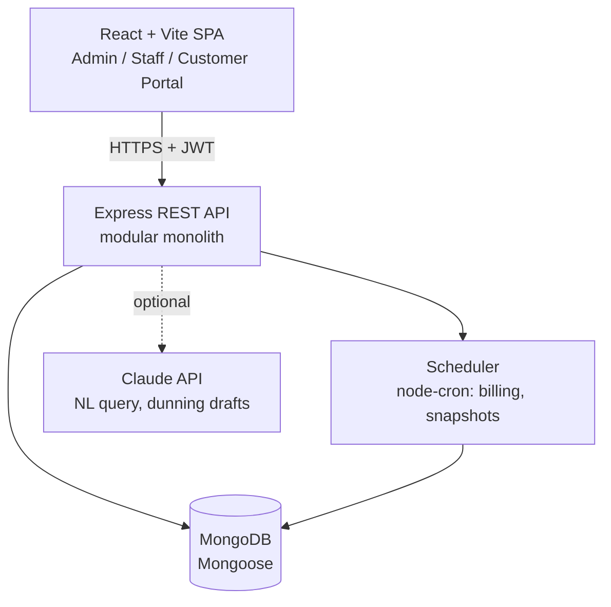

# NexSub Subscription Management System

> One platform to run plans, subscriptions and recurring billing: from catalog setup to invoices, payments and revenue reporting.


## The Problem

NexSub is a unified subscription management platform designed to automate the complete subscription lifecycle for businesses.

It replaces spreadsheets, manual invoicing, and disconnected payment tracking with a centralized system that enables admins, staff, customers, and finance teams to manage subscriptions efficiently.

## The Solution

# NexSub – Subscription Management System

NexSub is a unified subscription management platform designed to simplify and automate the complete subscription lifecycle for businesses. It enables admins to manage products, plans, pricing, variants, taxes, and discounts while allowing staff to handle customer subscriptions, quotations, invoices, and payments. The system automates recurring billing, invoice generation, subscription renewals, and payment tracking, reducing manual errors and missed renewals. It also provides a customer self-service portal where users can manage their subscriptions and view invoices, along with a centralized analytics dashboard for tracking active subscriptions, revenue, outstanding payments, and overdue invoices. Built with a scalable architecture, NexSub aims to streamline subscription operations, improve financial visibility, and deliver an efficient billing experience for businesses.


Add a concise feature listClarify NexSub’s target users


```
Catalog -> Quotation -> Subscription -> Auto-Invoice -> Payment -> Revenue Reporting
```


## Key Features

**Core**
- Role-based access: **Admin**, **Staff**, **Customer** (own data only)
- Secure auth with password rules, unique emails and email-based password reset
- Products with variants (e.g. Brand = Odoo adds 560), plans (daily/weekly/monthly/yearly) with per-plan close, pause and renew rules
- Quotation templates with validity period
- Subscription lifecycle: `Draft -> Quotation -> Confirmed -> Active -> Closed`
- Automated invoice generation with taxes and discounts applied by rule
- Invoice lifecycle: `Draft -> Confirmed -> Paid` (confirm, cancel, send, print PDF)
- Discount rules (fixed or percent, min purchase or quantity, date window, usage limit)
- Payment recording (method, amount, date, note) with outstanding and overdue tracking
- Finance dashboard: active subscriptions, revenue, outstanding, overdue, with filters

**Differentiators**
- **Idempotent billing:** a unique compound index on `(subscription, periodStart)` guarantees nothing is billed twice; catch-up logic guarantees nothing is skipped
- **Billing Run console** with dry-run preview and per-subscription result log
- **Demo Clock** to simulate a whole billing month in minutes
- **Margin guard** warns when a discount drops below the cost-based floor
- **Price explainer** shows how every invoice line was calculated
- **Optional AI (Claude API):** natural-language report queries and dunning email drafts, behind a feature flag; billing works with AI off

## Architecture



**Billing run flow**

```
Cron job or "Run now"
  -> atomically claim ACTIVE subscriptions with nextBillingDate <= run date
     (findOneAndUpdate sets a short lock lease, so parallel runs never grab the same one)
  -> per subscription, in one Mongo transaction:
       price -> discount -> tax (pricing engine)
       insert invoice (unique on subscription + periodStart)
       increment discount usage (guarded: usedCount < usageLimit)
       advance nextBillingDate (loop until caught up)
       auto-close if expired and plan allows
  -> log result: CREATED | SKIPPED_DUPLICATE | FAILED(reason)
```

## Tech Stack

| Technology | Use |
|---|---|
| React.js + Vite | Frontend |
| Node.js | Backend runtime |
| Express.js | REST API |
| MongoDB + Mongoose | Database |
| JWT | Authentication |
| bcrypt | Password hashing |
| Tailwind CSS | UI styling |
| Recharts | Dashboard charts |

Small supporting libraries: `zod` (validation), `node-cron` (scheduler), `nodemailer` (reset links and invoice emails), `pdfkit` (invoice PDFs), `helmet`, `cors`, `express-rate-limit`, `@anthropic-ai/sdk` (optional AI).

## Project Structure

```
.
├── client/                     # React + Vite
│   └── src/
│       ├── pages/              # admin/, staff/, portal/, auth/
│       ├── components/         # tables, status chips, charts (Recharts)
│       ├── hooks/ api/ routes/ # data fetching, axios client, role-guarded routes
│       └── main.jsx
├── server/
│   └── src/
│       ├── modules/            # auth, users, catalog, rules, quotations, subscriptions,
│       │                       # pricing, billing, invoices, payments, reports, ai
│       ├── models/             # Mongoose schemas
│       ├── middleware/         # auth, rbac, validate, error handler
│       ├── jobs/               # billing scheduler, daily metrics snapshot
│       ├── seed/               # demo data generator
│       └── app.js
├── docker-compose.yml          # MongoDB (replica set), server, client
├── .env.example
└── README.md
```

## Getting Started

### Prerequisites

- Node.js 20+
- MongoDB 7+ running as a **replica set** (needed for transactions). MongoDB Atlas free tier works out of the box; the included `docker-compose.yml` starts a single-node replica set locally.


## Roadmap

- [x] Auth, RBAC, staff management
- [x] Catalog: products, variants, plans
- [x] Taxes, discounts, quotation templates
- [x] Subscription and invoice state machines
- [x] Idempotent billing run
- [x] Payments and overdue tracking
- [x] Finance dashboard and customer portal
- [ ] Mid-cycle proration on seat changes
- [ ] Online payment gateway (test mode)
- [ ] Usage-based billing lines
- [ ] Multi-currency

> Tick the boxes to match what is actually built before submitting.

## Assumptions

1. Plan price applies to the plan's main product line; add-on lines use product sales price plus variant extra. Prices are snapshotted on the line.
2. Taxes are exclusive by default and resolved by rule (product, product type, default).
3. Overdue is derived (`Confirmed` and `dueDate < today` and `amountDue > 0`), never stored.
4. One line-level plus one subscription-level discount per invoice; best value wins at each level.
5. Partial payments allowed; invoice is `Paid` only when `amountDue = 0`.
6. Pause stops invoice generation; resume re-anchors the next billing date.

## Team

| Name | Role |
|---|---|
| `<Aditya Jurel>` | Backend: auth, RBAC, catalog, deployment |
| `<Anupam Dwivedi>` | Backend: pricing engine, state machines, billing run, payments |
| `<Avichal Bajpai>` | Frontend: admin and staff consoles |

